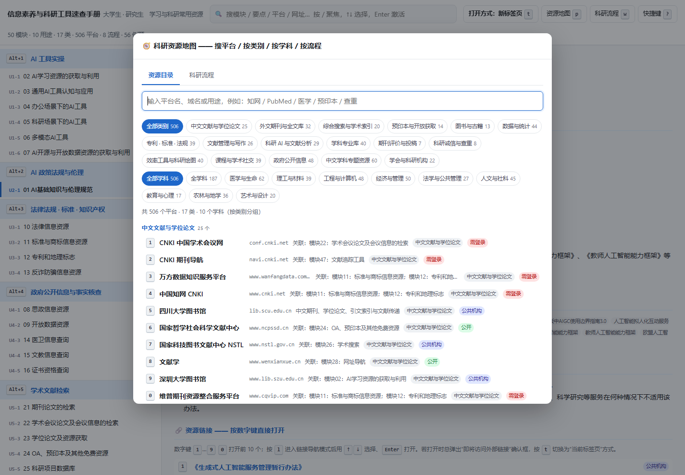
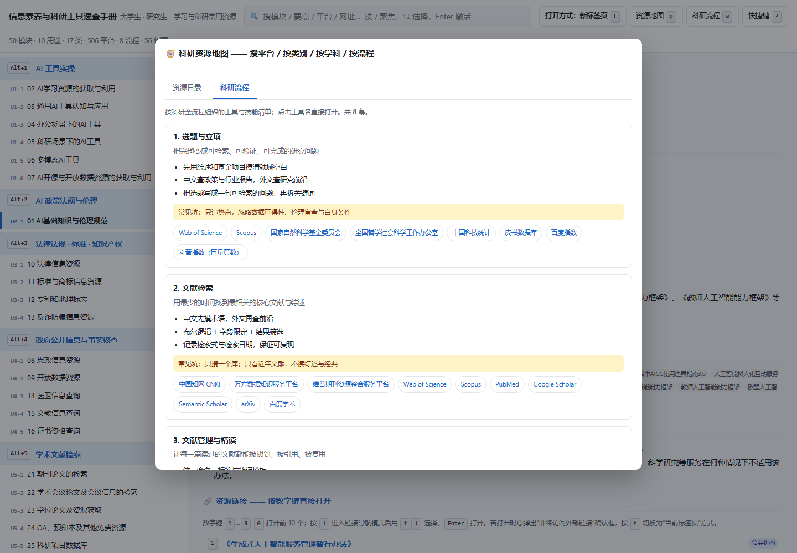
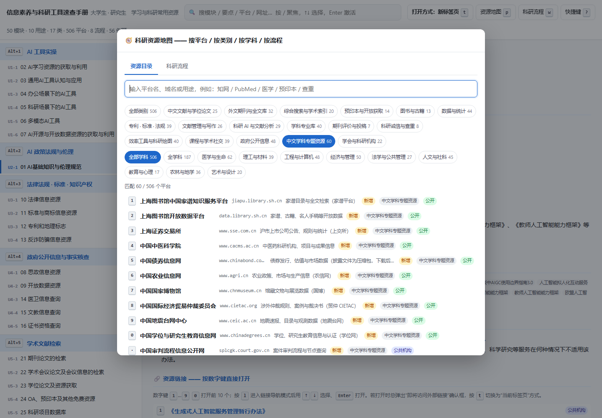

# 信息素养与科研工具速查手册

一份给**大学生 / 研究生**用的单文件速查手册：把学习与科研中常用的 **506 个平台和资源**
（**17 个类别 / 10 个学科**）、**50 个知识模块**、**8 幕科研流程**、**56 道例题**
整理在一页里，用键盘就能秒查秒开。

> 打开 [`信息素养与科研工具速查手册.html`](信息素养与科研工具速查手册.html) 即可使用。
> 单文件、**完全离线**（不引用任何外部 CDN），双击用浏览器打开，也可以拷到 U 盘、发到手机。


<details>
<summary>资源地图 · 资源目录（按 <kbd>p</kbd> 呼出）</summary>



</details>

<details>
<summary>资源地图 · 科研流程（按 <kbd>w</kbd> 呼出）</summary>



</details>

<details>
<summary>中文学科专题资源（C16 筛选，60 条）</summary>



</details>

---

## 它解决什么问题

写论文、做课程作业、查政策法规、找统计数据的时候，真正的耗时往往不是思考，而是
**“那个网站叫什么来着 / 入口在哪 / 检索式怎么写”**。这份手册把这些压进了键盘操作：

- 记得网站名、不记得网址 → 按 `p`，输入“知网”“国家标准”“专利”，按 `1` 直接打开
- 不知道某类信息该去哪个库 → 按 `Alt+1`…`Alt+0` 按**使用场景**跳转（不是按学科分类）
- 检索式写不对 → 翻「检索语法与策略」那一类，里面有布尔逻辑、截词、字段限定、精确／模糊匹配
- 不确定某平台怎么进某个功能 → 每个模块都附了**官方要点原文 + 例题与答案解析**

---

## 内容概览

| 内容 | 数量 |
| --- | --- |
| 知识模块 | 50 个 |
| 使用场景分类 | 10 类 |
| 平台 / 资源 | **506 个**（原有 200 + 新增 306） |
| 资源类别 | **17 类** |
| 学科标签 | **10 个**（全学科 + 9 个学科群） |
| 科研流程 | **8 幕 / 66 个工具挂载** |
| 例题（含答案与解析） | 56 道 |
| 实践任务 | 99 条 |

**10 个使用场景分类**：

| 快捷键 | 分类 | 什么时候用 |
| --- | --- | --- |
| `Alt+1` | AI 工具实操 | 用 AI 产品找功能、生成内容、完成操作 |
| `Alt+2` | AI 政策法规与伦理 | 查 AI 相关法规、规范性文件的条款与适用范围 |
| `Alt+3` | 法律法规 · 标准 · 知识产权 | 查法条、判例、国家标准、商标、专利、地理标志 |
| `Alt+4` | 政府公开信息与事实核查 | 查统计数据、年鉴、开放数据、医卫／文教／证书资质 |
| `Alt+5` | 学术文献检索 | 在学术数据库里检索期刊、会议、学位论文并取全文 |
| `Alt+6` | 检索系统与搜索工具 | 学术搜索、图片搜索、网址导航、网络指数、馆藏系统 |
| `Alt+7` | 检索语法与策略 | 布尔逻辑、截词、字段限定、精确／模糊匹配、结果筛选 |
| `Alt+8` | 图书 · 课程 · 学习资源 | 找电子书、开放课程、慕课、国家图书馆数字资源 |
| `Alt+9` | 文献管理 · 写作 · 排版 | 文献管理软件、参考文献著录、投稿选刊、论文排版 |
| `Alt+0` | 通用工具与知识管理 | 思维导图、笔记、插件、截图录屏、PDF、数据处理与可视化 |

---

## 资源地图（v2.2 起）

按 `p` 打开资源地图，里面有两个视图：

**资源目录** —— 506 个平台按 **17 类**组织，可按 **10 个学科**筛选：

| 类别 | 代表资源 |
| --- | --- |
| C01 中文文献与学位论文 | 知网、万方、维普、CSCD、CSSCI、NSTL、CASHL |
| C02 外文期刊与全文库 | ScienceDirect、Wiley、SpringerLink、SAGE、ACS、RSC、IEEE、ACM |
| C03 综合搜索与学术索引 | Web of Science、Scopus、EI、Google Scholar、Semantic Scholar、OpenAlex |
| C04 预印本与开放获取 | arXiv、bioRxiv、medRxiv、SSRN、ChemRxiv、DOAJ、Unpaywall |
| C05 图书与古籍 | 国家图书馆、CADAL、HathiTrust、Internet Archive、书格 |
| C06 数据与统计 | 国家统计局、国家科学数据中心群、CFPS/CGSS、CSMAR、Wind、IMF/OECD |
| C07 专利 · 标准 · 法规 | CNIPA、Espacenet、Google Patents、ISO、IEC、北大法宝、Westlaw |
| C08 文献管理与写作 | Zotero、EndNote、NoteExpress、Overleaf、LaTeX、Mathpix、DeepL |
| C09 科研 AI 与文献分析 | Elicit、Consensus、Scite、SciSpace、ResearchRabbit、CNKI AI、Kimi |
| C10 学科专业库 | PubMed、Embase、Cochrane、GEO、PDB、UniProt、SciFinder、MathSciNet、ERIC |
| C11 期刊评价与投稿 | JCR、LetPub、SJR、JANE、Think.Check.Submit |
| C12 科研诚信与查重 | 知网/维普/万方检测、Turnitin、iThenticate、Retraction Watch、PubPeer |
| C13 效率工具与科研绘图 | Obsidian、draw.io、Origin、GraphPad、SPSS、Stata、R、Jupyter |
| C14 课程与学术社交 | 中国大学 MOOC、Coursera、edX、ORCID、ResearchGate、科学网 |
| C15 政府公开信息 | 教育部、科技部、NSFC、央行、海关、财政部、自然资源部、气象局 |
| C16 中文学科专题资源 | 疾控中心、药审中心、贸仲、上交所、巨潮、CHFS、上海图书馆家谱、国博 |
| C17 学会与科研机构 | 中华医学会、中国法学会、中国社科院、中国农业科学院、中国数学会 |

**科研流程** —— 按 `w` 直接打开，8 幕：

> 选题与立项 → 文献检索 → 文献管理与精读 → 数据与实验 → 分析与可视化 →
> 写作与排版 → 查重与投稿 → 传播与交流

每一幕给出目标、3 条要点、1 条常见坑和 4–10 个推荐工具；点工具名直接打开。

> 资源地图内：输入即过滤；点类别/学科筛选；数字键 `1`…`0` 打开前 10 个结果。
> 顶部搜索框也能搜到流程，例如输入“查重”“投稿”“预印本”，回车直达对应幕。

---

## 快捷键

| 键 | 作用 |
| --- | --- |
| `/` 或 `Ctrl+K` | 聚焦搜索框（同时搜模块标题、学习要点、关键词、平台、网址） |
| `Alt+1` … `Alt+9` `Alt+0` | 直达第 1–10 个使用场景分类 |
| `[` / `]` | 上一个 / 下一个分类 |
| `↑` `↓`（或 `k` `j`） | 在模块目录中上下移动 |
| `Enter` | 打开选中的模块 |
| **`1` … `9` `0`** | **打开当前模块的第 1–10 个资源网址**（新标签页） |
| `l` | 进入链接导航模式，`↑↓` 选链接、`Enter` 打开（第 11 个之后的链接） |
| **`p`** | **资源地图 · 资源目录**（506 个平台，17 类 / 10 学科，输入即过滤，`1`…`0` 打开前 10 个结果） |
| **`w`** | **资源地图 · 科研流程**（8 幕，点工具名直接打开） |
| **`t`** | **切换打开方式：新标签页 ⇄ 当前标签页** |
| `o` / `y` | 打开 / 复制当前模块的原始页面地址 |
| `Esc` / `?` | 关闭浮层 / 显示快捷键帮助 |

**最常用的操作**：想到某个平台 → 按 `p` → 输入名字 → 按 `1`。

---

## 常见问题

**Q：点网址时弹出“即将访问外部链接，相关内容与服务由第三方提供。”怎么办？**

这是**宿主环境**（App 内置浏览器、受管控浏览器等）对外部链接的安全策略，不是手册本身的行为。
按以下顺序试：

1. 按 `t` 切换到「当前标签页」方式再打开 —— 如果不再弹，说明它拦的是“开新窗口”
2. 如果仍弹，说明它拦的是“访问外部域名”，此时用打开后底部提示条上的 **「复制链接」**，
   粘到系统浏览器地址栏打开
3. 最彻底的办法：把 HTML 保存到本地，**右键 → 打开方式 → Chrome / Edge**

> 用系统浏览器（Chrome、Edge、Firefox）直接打开不会有这个问题。
> 详见 [版本说明](CHANGELOG.md) 中 v2.0 的排查过程。

**Q：资源地图里的“需国际网络”“需登录”是什么意思？**

- **需国际网络**：Google Scholar、ChatGPT、Gemini、NotebookLM、Perplexity、Hugging Face 等
  在当前网络环境下不能直连；用途说明里已标注，可在可访问国际网络时使用。
- **需登录 / 部分免费**：Web of Science、Scopus、EI、Embase、Cochrane、SciFinder、Reaxys、
  北大法宝、威科先行、Westlaw 等需要学校/机构订阅；先用校园网或图书馆入口访问。
- 手册只负责“找到入口”，不提供账号、不绕过任何付费墙。

**Q：中文学科库做过安全检查吗？**

做过。每个新增中文网址都检查了 DNS、HTTPS/TLS 证书（含到期日）、HTTP 状态与重定向、
Content-Type、强制下载、外部 iframe/脚本与可执行文件链接；81 个 HTML 样本还用 Windows Defender
做了文件级扫描，未发现威胁。15 个仅支持 HTTP 的站点已在用途说明中标注“HTTP 明文，注意”；
中国债券信息网的披露文件是 `.zip`，下载后请先扫描。逐站结果见
[`中文学科库补充说明.md`](中文学科库补充说明.md) 附录 A。

**Q：中科院期刊分区表还能查吗？** 官方在线平台已于 **2026-09-30 停止运行**，
中科院文献情报中心自 2026 年起不再更新、发布分区表；多数高校明确 2026 年及以后论文
按 **2025 版分区表**认定（以本单位政策为准）。手册里保留了 JCR、LetPub、SJR 等可用入口，
并在 LetPub 的用途说明中标注了这一变化。

**Q：需要联网吗？** 手册本身完全离线，点开的具体网站需要联网。

**Q：能打印吗？** 可以，但它是按屏幕浏览设计的，直接看更方便。

---

## 仓库里的界线：发布内容 vs 本地工作区

本仓库**只跟踪对外发布的内容**。抓取数据、构建脚本、诊断脚本都留在本机，不进版本库 ——
这样以后更新时，`git status` 里只会出现你真正想发布的改动，不会混进一堆中间文件。

| 类别 | 位置 | 是否上传 |
| --- | --- | --- |
| **成品手册** | `信息素养与科研工具速查手册.html` | ✅ 上传 |
| **历史版本** | `考点速查手册.html`、`bug修复/*.html` | ✅ 上传 |
| **文档** | `README.md`、`CHANGELOG.md`、`资源清单.md`、`bug修复/修复说明.md` | ✅ 上传 |
| **截图** | `screenshots/` | ✅ 上传 |
| 构建 / 诊断脚本 | `*.py`、`*.js`、`诊断脚本/` | ❌ 仅本地 |
| 抓取数据与中间产物 | `raw/`、`out/` | ❌ 仅本地 |
| 本地依赖与第三方 PDF | `libs/`、`pdf/` | ❌ 仅本地 |

> **日常维护只需要做一件事**：改完手册或文档后，`git add` 你看得见的那几个文件 → `git commit` → `git push`。
> 被 `.gitignore` 挡住的东西不会自动混进来。

---

## 仓库结构

```
【上传区】被 git 跟踪
├── 信息素养与科研工具速查手册.html   ← ★ 成品，双击即用
├── README.md                          本文件
├── CHANGELOG.md                       按时间顺序的版本说明
├── 科研资源扩充说明.md                  v2.2 现状对比、缺口分析、框架与执行结果
├── 中文学科库补充说明.md                v2.3 中文学科库、安全核验与纳入/剔除记录
├── 资源清单.md                         完整资源清单（Markdown 报告）
├── 考点速查手册.html                   初版（v1.0）存档
├── screenshots/                        预览截图
└── bug修复/                            历次修订记录
    ├── 考点速查手册-v2.0.html
    ├── 修复说明.md                      v2.0 问题的完整排查过程
    └── 问题截图.png                     现象截图

【工作区】仅本地，不上传（.gitignore 已排除）
├── build_data.py / report.py / url_fixes.py   构建与维护
├── research_catalog.py                        资源目录与 8 幕流程数据
├── research_catalog_cn.py                     中文学科库候选与最终清单
├── verify_catalog.py                          新增网址 HTTP 实测
├── verify_cn_catalog.py                       中文库 DNS/TLS/页面安全检查
├── extract.py / fetch.py / linkcheck.py       抓取与链接检测
├── dlpdf.py / pdfparse.py / pdfimg.py         附件下载与 PDF 解析
├── bug修复/build_html_v2.py 等                 生成脚本与回归测试
├── 诊断脚本/                                   一次性排查脚本
├── out/  raw/                                 抓取数据与中间产物
└── libs/  pdf/                                本地依赖与第三方 PDF 原文
```

---

## 重新生成（仅本机需要，脚本不上传）

```powershell
python extract.py                      # raw API → out/knowledge_raw.json（数据未更新时可跳过）
python verify_catalog.py               # 可选：实测 research_catalog.py 里的新增网址
python verify_cn_catalog.py            # 可选：中文库 DNS/TLS/内容安全核验
python build_data.py                   # 原始数据 + 资源目录 → out/app_data.json
python "bug修复/build_html_v2.py"      # → 信息素养与科研工具速查手册.html
node  "bug修复/check_v2.js"            # 78 项回归测试
python report.py                       # → 资源清单.md
```

> 新增/修改资源只改 `research_catalog.py`：每条含名称、网址、类别、学科、一句话用途。
> 重新生成时 `build_data.py` 会自动与原有 200 个平台去重合并；流程工具名找不到会直接报错。

### 网址变更了怎么办

只改 [`url_fixes.py`](url_fixes.py) 里的 `URL_FIXES`，然后重跑上面的生成流程。
所有下游文件（手册、报告、链接检测）会自动带上勘误，不会因为重新生成而回退。

```python
URL_FIXES = {
    "https://旧地址": "https://新地址",
}
```

---

## 数据来源

内容抓取自 <https://csc.xxsuyang.com/Knowledge>。该页面是 Vue 单页应用，
正文由接口异步加载；本项目通过解析前端产物定位官方接口后直接取结构化数据：

| 接口 | 作用 |
| --- | --- |
| `GET /SCC/Website/GetParentList?kind=csc2025` | 知识点分类（9 个） |
| `GET /SCC/Website/GetKnowledgeList?kind=csc2025` | 全部知识模块（50 条，含正文） |

接口网关：`https://jsgateway.zhixinst.com`

数据版权归原发布方所有；本仓库不包含抓取到的 PDF 原文（见 `.gitignore`），
需要时按资源清单里的链接自行下载。

> v2.2/v2.3 新增的 306 个资源目录由本地 `research_catalog.py` 与 `research_catalog_cn.py`
> 维护，参考高校图书馆数据库导航、官方站点与 2026 年科研工具评测整理；
> 网址均经 HTTP 实测，中文学科库还额外做了 TLS 证书与页面静态安全检查，**不属于源站数据**。
> 完整对比与证据见 [`科研资源扩充说明.md`](科研资源扩充说明.md) 与
> [`中文学科库补充说明.md`](中文学科库补充说明.md)。

---

## 版本

当前 **v2.3.2**。完整迭代记录见 [CHANGELOG.md](CHANGELOG.md)，概览：

| 版本 | 日期 | 变更 |
| --- | --- | --- |
| v1.0 | 2026-10-13 | 初版：按用途重排 50 个知识模块 |
| v2.0 | 2026-10-16 | 修复键盘打开网址被环境拦截、反复弹确认框 |
| v2.1 | 2026-10-16 | 修正已变更的网址；用途从比赛专用改为通用学习科研工具 |
| v2.1.1 | 2026-10-27 | 维护修订：资源清单同步到 v2.1 口径；修复重新生成链路 |
| v2.2.0 | 2026-10-27 | 资源地图：平台 200 → 419，新增 15 类 / 10 学科 / 8 幕科研流程；219 个新增网址实测；78 项测试 |
| v2.3.0 | 2026-10-28 | 中文学科库：+74 中文资源，新增 C16/C17，平台 493 / 17 类；逐站 TLS 与安全核验；78 项测试 |
| v2.3.1 | 2026-10-28 | 回补 5 个 HTTPS 正式入口；平台 498 / 17 类；79 个中文资源逐站安全表；78 项测试 |
| **v2.3.2** | **2026-10-28** | **再回补 8 个 HTTP 明文入口（均加显著提示）；平台 506 / 17 类；87 个中文资源安全表；78 项测试** |
